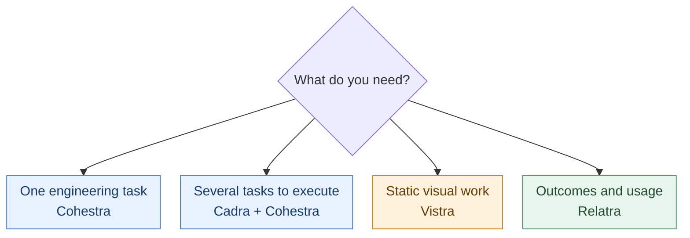
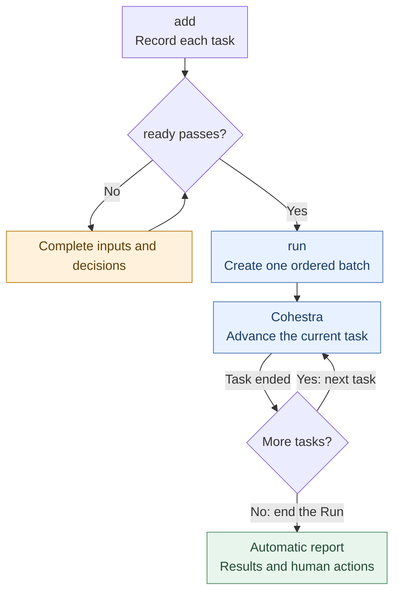
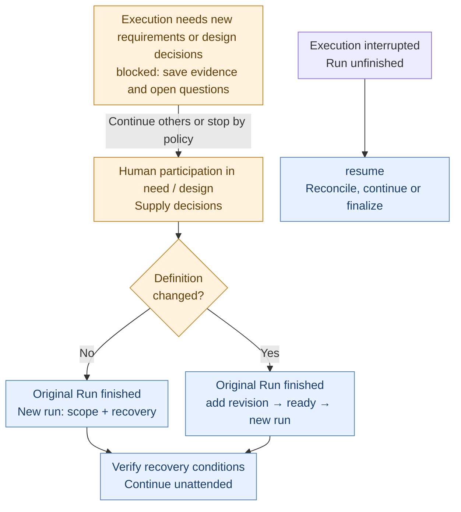
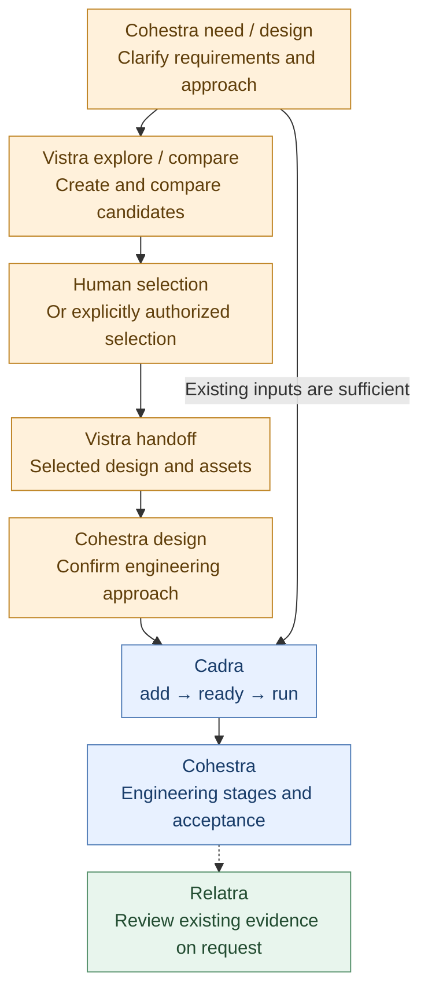

# YUZIO Skills

**English** · [中文](README.zh-CN.md)

Reusable agent skills maintained in one repository. Each skill directory is a complete installation unit; repository tests and maintenance documents are not runtime dependencies.

## Skills



| Skill | Purpose | Entry | Version and protocol |
|---|---|---|---|
| cohestra | Initializes project context and runs engineering stages, drift checks and read-only reports as needed | [SKILL.md](cohestra/SKILL.md) | [release.json](cohestra/release.json) |
| cadra | Prepares tasks, calls Cohestra serially, and manages execution state and recovery | [SKILL.md](cadra/SKILL.md) | [release.json](cadra/release.json) |
| relatra | Reports agent outcomes, outstanding work and observed usage across selected projects | [SKILL.md](relatra/SKILL.md) | [release.json](relatra/release.json) |
| vistra | Reviews, explores, compares and hands off static mobile, desktop and brand visuals | [SKILL.md](vistra/SKILL.md) | [release.json](vistra/release.json) |

Each package owns its execution rules. Cohestra executes one stage per call; Cadra requires an available Cohestra skill to execute engineering stages. Relatra requires Python 3.9+ and uses only the standard library. Vistra requires host image capabilities to generate or edit images.

## Install

Run the installation command for each skill you need from the target project's root:

```sh
npx skills add yuzio-ai/skills --skill cohestra
npx skills add yuzio-ai/skills --skill cadra
npx skills add yuzio-ai/skills --skill relatra
npx skills add yuzio-ai/skills --skill vistra
```

Installation defaults to project scope; add `-g` for user scope or `-a <tool-a> <tool-b>` to select tools. Use the source repository's absolute path for unpublished local content. Alternatively, copy the complete skill directory to a location supported by the host, including references, templates, scripts and hidden files. Installation does not initialize business projects.

See the [installation guide](cohestra/references/installation.md) for installation, updates and troubleshooting. Confirm that the host discovers the entry and check the actual loaded directory and `release.json`; do not assume precedence between project and user copies. Updating a skill does not migrate existing project data. Preserve unsupported old-protocol data and follow the relevant skill rules.

## Invocation

Jump to: [Cohestra](#cohestra) · [Cadra](#cadra) · [Relatra](#relatra) · [Vistra](#vistra).

After installation, enter `$skill-name entry` in the agent chat, followed by the project, target, goal and constraints. The examples below are **chat prompts, not terminal commands**. Replace `<…>` with actual values; other hosts use their own skill invocation syntax. Examples retain the Chinese labels used in the skill prompts.

Cohestra and Cadra default to the current task's project. Relatra needs a defined project set; Vistra needs a clear design target. Discussing skill rules does not start execution. Skills can be used independently; install only those needed and their actual dependencies. Every task need not use all 4. Engineering delivery does not itself authorize commits, pushes or releases.

| Term | Meaning |
|---|---|
| slug | Stable task ID, such as `search-history`; used to select or edit that task |
| Run / run-id | One execution batch and its ID; one Run can contain several tasks |
| handoff | A stage's delivery file, passed to later stages by its actual path |
| candidate | A fixed implementation version for review or acceptance: a commit or reproducible snapshot |

### Cohestra

Advance one engineering task. Start at any stage; **each call executes one stage**. If no entry is specified, the skill selects one based on the goal.

| Entry | Purpose |
|---|---|
| `init` | Initialize or reuse project context without executing a task |
| `need` | Clarify requirements, scope and acceptance criteria |
| `design` | Define the approach, implementation plan and validation methods |
| `code` | Implement clear requirements or an established design |
| `review` | Review a fixed candidate and report findings |
| `fix` | Assess and fix review findings |
| `validate` | Gather validation evidence and assess acceptance |
| `verify` | Check a stage's output against its upstream basis for drift |
| `report` | Read-only overview of project tasks, outstanding work and state anomalies |

```text
$cohestra design
项目：<项目绝对路径>
需求：为搜索增加历史记录，最多保存 20 条，支持单条删除和清空。
```

To continue a task, attach the previous handoff file or task directory. Stage calls announce and minimally initialize missing project context; `report` neither initializes nor writes files. Execution data lives in `.yuzio/cohestra`; necessary formal documents follow project conventions.

<details>
<summary>Acceptance, drift checks and evidence boundaries</summary>

`validate` assesses acceptance of a candidate. `verify` only checks a stage's output against its upstream basis; it does not modify implementation, supply acceptance evidence or replace review. These are independent calls; choose the one matching the goal. Cadra does not invoke `verify` automatically:

```text
$cohestra validate
任务目录：<已有任务目录绝对路径>
候选：<固定提交 SHA 或可复核快照>
验收依据：<已确认的需求及验收条件>

$cohestra verify
被核对：<design 交付文件绝对路径>
上游依据：<对应 need 交付文件绝对路径>
```

Identify the original task directory when continuing work. Automatic input handoff does not execute subsequent stages. A stage that reads business code without changing it can still write handoff files; `report` is the query entry that writes nothing. Checks and acceptance apply to a fixed candidate. A passing build does not establish runtime acceptance, and switching stages does not make the same author's review independent.

Review follows applicable risks through actual callers, assembly and lifecycle paths, with evidence for the fixed candidate and necessary unchanged dependencies. Zero findings do not establish complete coverage. Review fills coverage gaps within existing authorization first; if required paths cannot be verified, it reports blocked. Validate checks coverage and re-review evidence for the final candidate. See [Risk coverage](cohestra/references/review-coverage.md). Standalone calls default to one agent; Cadra's explicit worker/reviewer arrangement follows [Orchestration dispatch](cohestra/references/workflow.md#编排派发).

</details>

Full rules: [Cohestra](cohestra/SKILL.md).

### Cadra

Prepare tasks, execute them serially and recover interrupted runs. Engineering stages use Cohestra. Before execution, confirm a writable business-project Git working tree and a loaded Cohestra version supporting Cadra's required contract and unattended mode. Cadra does not create a Git repository or run business tasks in this skill source repository. Relevant write entries minimally initialize missing project containers; installing skills and initializing a project are separate actions.

| Entry | Purpose |
|---|---|
| `add` | Create or edit a task's requirements, priority, dependencies and flow |
| `ready` | Check whether goals, scope, acceptance criteria, inputs and dependencies permit execution |
| `list` | Read-only view of tasks, queues and runs |
| `run` | Create a run and execute tasks serially; defaults to all ready tasks; automatically report after finalization |
| `append` | Atomically append admitted tasks to a running Run |
| `resume` | Continue or finalize an unfinished run; automatically report after finalization |
| `report` | Generate a summary file for a run and register its report link |

For the current protocol, `report` writes a file and registers its link. For historical 0.6/0.7 Runs, `report` only displays read-only output in chat and adds no files or links.

After `run` or `resume` successfully finalizes and rereads a `completed` Run or a `stopped` Run whose entries have all ended, it automatically generates a report for that exact Run. The reply gives Run and report paths, result counts and necessary human actions, using saved results without repeating engineering stages or acceptance. Unfinished Runs do not automatically produce reports. A repeated `resume` on an already closed Run stays read-only; use manual `report` for a missing report, a progress report or a different focus. Report failures preserve execution results; if only link registration fails, retain the file and retry registration using its exact path instead of generating another report. Necessary formal project summaries still follow project conventions.

The recommended engineering combination is **Cadra for tasks and runs, with Cohestra for engineering stages**. `add` only records a task, `ready` checks admission, and `run` invokes Cohestra automatically within the task's flow. If requirements or the approach are unsettled, invoke `$cohestra need` / `$cohestra design` separately first, then set Cadra's flow to specify the implementation starting stage and allowed scope.

`add` uses scoped reads for creation, editing, existing-delivery binding and historical-protocol upgrades. It checks definitions, reachable dependency graphs and Run ownership, then saves and rereads the Task; missing business inputs remain explicit gaps. It loads revision maintenance when editing and identity checks when binding, without preloading execution rules. Dependency completion, candidate suitability, the full execution contract and legal first actions belong to `ready` and subsequent execution checks. Existing context can confirm identity, but cannot waive these admission checks. Independent reads are batched; relevant records are reread before writing. No persistent cache or extra runtime dependency is introduced. See [add](cadra/references/add.md).

#### Choose a flow

| Flow | Start | Allowed stages | Use |
|---|---|---|---|
| `implementation` (default) | code | code, review, fix, validate | Implement clear goals, scope and authorization; also use for defects needing investigation |
| `bugfix` | fix | fix, review, validate | Remediate a known defect with established evidence and expected behavior |
| `review-only` | review | review | Review a fixed candidate without automatic fixes or acceptance |

A nonempty list containing only these four stages is also supported. Its first item sets the start; the remaining items define allowed scope, not execution order, and the last item does not declare an endpoint. Initial execution and restarts after requirements/flow revisions use that start; continuation and recovery determine the first action from the legal contract and admission rules. Implementation receives independent review; mandatory fixes require fix and re-review, and complete coverage with no mandatory fixes remaining permits validation within the allowed flow. Optional suggestions are deferred by default. Mandatory findings block review-only tasks rather than expand their scope.

Prepare need/design outside Cadra with human participation. Existing decisions remain valid; small tasks need no fabricated earlier handoffs. Resolve goals, acceptance, product decisions and necessary design through interactive `$cohestra need` / `$cohestra design` before admission. A return to need/design during execution blocks for human input instead of completing the task.

#### Examples for each flow

These are three independent tasks. Replace paths and candidates; send each call separately.

```text
$cadra add
项目：<项目绝对路径>
任务：搜索历史
需求：按已确认方案增加最多 20 条搜索记录，支持单条删除和清空；不改搜索算法。
输入：<已确认需求、工程方案和必要视觉交付>
验收：重启后保留记录，删除与清空有效，超过 20 条移除最旧记录。
流程：implementation

$cadra add
项目：<项目绝对路径>
任务：修复空搜索崩溃
需求：按已有定位修复空输入崩溃；提示填写关键词且不发起请求。
输入：<复现记录、日志和已有定位依据>
验收：空输入不崩溃且不发请求，正常关键词仍可搜索。
流程：bugfix

$cadra add
项目：<项目绝对路径>
任务：审查账单导出实现
需求：审查固定候选的数据范围、CSV 内容和错误处理；不修改生产代码。
输入：<候选提交 SHA 或可复核快照>、<需求与验收条件>
验收：问题带位置、影响和证据；无问题时说明实际覆盖范围。
流程：review-only
```

#### Execute multiple tasks automatically



The chart shows the default behavior of continuing after a blocked or failed task; the per-task stop policy takes precedence.

Each `add` returns a slug. Run `ready` for each selected task, then start one `run` after they pass. There is no need to invoke Cohestra stages manually. For one implementation and one bugfix, send each call separately and wait for its result before proceeding:

```text
$cadra ready
任务：<implementation 任务的 slug>

$cadra ready
任务：<bugfix 任务的 slug>

$cadra run
范围：<implementation 任务的 slug>、<bugfix 任务的 slug>
```

**What to copy from replies** — these values are illustrative, not completed executions. Use the values actually returned for your task. `YYYYMMDD` is a date placeholder; response wording is not a fixed protocol.

| Reply source | Illustrative returned value | Use it in |
|---|---|---|
| `add` | slug: `search-history` | `ready` task or `run` scope |
| `run` | run-id: `run-YYYYMMDD-01` | `resume` Run if interrupted; optional manual `report` Run |
| Cohestra stage | Absolute path of the returned handoff | Downstream stage input or `add` reference inputs |

Copy task and Run IDs into selection fields; copy the handoff's full path, including its filename, into reference inputs.

You can also use `范围：全部 ready`. Execution follows priority from high to low, then slug alphabetical order; the scope list does not set execution order. By default, a blocked or failed task does not stop later tasks. To stop the queue when that task fails or is blocked, set `执行策略：stop_queue_on_failure: true` during `add`.

Dependencies must already be completed for admission. If B depends on A, execute A first, check B with `ready`, then append it to a still-running Run or establish a subsequent batch. An unfinished dependency chain cannot enter one run together. A project can have at most one unfinished run. Use `resume` for interruptions; after a finished run, resolve gaps and explicitly select failed tasks for recovery in a new `run`. The controller creates a worker and independent reviewer with clean context as each task needs them; review-only creates no worker, and reconciliation without stage calls creates no agents. Prefer reusing each role within its task, never across tasks. Tasks and stages remain serial; there is no scheduler or background service. Missing child-agent or identity-verification capabilities block execution explicitly.

After preparing additional tasks, append them while the original Run executes:

```text
$cadra append
Run：<running Run 的 run-id>
任务：<已 ready 的 slug 列表>
```

A batch is accepted or rejected as a whole. New tasks are sorted by priority and slug within the appended batch; dependencies must already be complete. Append neither takes ownership nor wakes the executor. Resume interrupted Runs first; closed Runs cannot be reopened.

| During a Run | What to do |
|---|---|
| A new requirement arrives | Use add and ready, then append to the running Run tail without reordering existing tasks |
| You want to stop | Send the executing agent a natural-language stop request, as below; there is no `$cadra stop` entry |

```text
停止当前 Run，并按 Cadra 规则收尾。
保留当前任务的实际执行结果，将后续未执行任务记为 skipped。
```

Finalization preserves actual results, marks the Run `stopped` and records unexecuted tasks as `skipped`, then automatically generates its report. If finalization is interrupted, use `resume` to reconcile it before creating another Run.

`run` rechecks admission when establishing a batch. Execution budgets are at most 2 failure retries per stage, 3 fix rounds for review blocking findings, and 16 stage calls per task per Run. If another call is needed but its budget is exhausted, the task is failed and listed for human action. `resume` does not reset budgets. See [Call contract and budgets](cadra/references/contract.md).

Use `list` to find actual slugs, current states and Runs. If several finished Runs exist and no run ID is supplied, manual `report` does not assume the latest one:

```text
$cadra list
项目：<项目绝对路径>
```

| State | Meaning | What to check next |
|---|---|---|
| Run completed | Every entry has ended; some may be blocked or failed | Inspect per-task results and human actions |
| Task completed | The configured scope ended | Check flow and acceptance; review-only does not establish engineering acceptance |
| Task skipped | Not executed in this Run | Apply original admission and recovery conditions before a new Run |

#### Human decisions and recovery



Cadra dispatches code/review/fix/validate in `unattended` mode; it does not dispatch need/design. If execution reveals a requirements or design decision that needs the user, or the next stage points to need/design, save the investigation, options and open questions, mark the task `blocked` and return it for preparation with human participation. Do not switch to interactive mode inside the Run or treat that flow boundary as completion.

| Preparation gap | Example requiring human input | Handling of the current task |
|---|---|---|
| Requirements decision | Existing requirements do not establish whether cross-device sync is in scope | Record the scope choice and its impact; block and return to `need` with human participation |
| Design decision | A major architecture tradeoff exceeds existing authorization and needs user selection or confirmation | Save candidates, recommendation evidence and open decisions; block and return to `design` with human participation |

Cadra records the required human action in the Run. It continues with the next task by default. If that task sets `stop_queue_on_failure: true`, it stops the queue and marks unexecuted tasks skipped. Review the Run's `report` and supply decisions addressing the actual gaps.

<details>
<summary>Recovery commands, task revisions and interrupted Runs</summary>

**A blocked task already has a terminal result in its original Run. Supplying a decision does not automatically rerun it.** Choose recovery based on whether the task definition changes:

- **Decision only, with no definition change**: After the original Run ends, no other unfinished Run exists in the project, and the blocking cause is resolved, explicitly select the slug and create a new Run for recovery. “All ready” cannot replace the recovery scope. This example applies when selecting an existing option without changing scope, flow, dependencies, execution policy or acceptance criteria:

```text
$cadra run
项目：<同一项目绝对路径>
范围：<受阻任务的 slug>
恢复：<同一 slug>
补充：已确认采用 <need/design 交付文件绝对路径> 中的方案 A；原任务范围、流程和验收条件不变，允许按该决定继续执行。
```

- **The decision changes the task definition**: After the original Run ends, edit the original slug with `add` and describe the change, run `ready`, then select that slug in the ordinary `run` scope. Do not put the revised task in the recovery list. Cadra still checks that prior blockers are resolved and selects the starting action under revision rules. Old acceptance does not establish acceptance of changed requirements.

Recovery does not simply skip the blocked stage. Cadra checks handoffs and recovery conditions, then takes a legal next action or retries the blocked stage within the permitted flow. Subsequent execution remains unattended. See [Recovery admission](cadra/references/recovery.md) and [Definition revisions](cadra/references/revision-rules.md).

Before freezing a Run, Cadra checks project and task prerequisites; future stage outputs are not admission inputs. See [Preflight](cadra/references/preflight.md). Run writes require Python and POSIX file locks. Check [Executor ownership](cadra/references/executor.md) before recovery: active or unknown liveness does not authorize takeover. [Version boundaries](cadra/references/compatibility.md) preserve old Runs and require explicit Task upgrades; an unfinished legacy Run continues with its original installation.

**`resume` handles confirmed execution interruptions**: it checks, continues or finalizes an unfinished Run. It does not rerun entries that already have blocked/failed results or reopen a finished Run:

```text
$cadra resume
Run：<未完成的 run-id>
```

</details>

Complete interactive `$cohestra need` or `$cohestra design` when preparation needs discussion, then use implementation in Cadra. To continue an existing Cohestra task, provide its original directory and explicitly confirm the binding; its legal next stage must be within the new allowed scope.

To edit a task, use `add` with its existing slug. Tasks belonging to an unfinished Run cannot be edited, even if their individual entries have ended. Changes to requirements, dependencies, flow or execution policy invalidate admission and require `ready` again; title or priority changes alone do not. The slug and Cohestra binding path stay stable; renaming or copying old records is not a recovery method.

A new task with a different goal can reference an existing Cohestra handoff without continuing the original task. Reuse the original task for the same goal. To continue it, the Cadra slug must match the original Cohestra task ID; provide the original directory and explicitly confirm the binding. The legal contract also determines the first action, not the preset alone. Report and repair damaged contracts, indexes or source records; deleting `.yuzio` and initializing again does not recover them.

Task definitions and execution records live in `.yuzio/cadra`. See [Flow](cadra/references/flow.md) and [Task and Ready Gate](cadra/references/task-rules.md) for the full rules.

Full rules: [Cadra](cadra/SKILL.md).

### Relatra

Review personal project outcomes through daily, weekly, monthly, quarterly, yearly or custom date-range reports.

```text
$relatra 周报
项目：<项目绝对路径，可明确列出多个项目>
报告目录：<报告目录绝对路径>
```

Defaults are the previous complete calendar period, Chinese and Asia/Shanghai time, with weeks running Monday through Sunday. Request “this week through now” for the current period, or specify another output language. Ask explicitly for rework, human intervention or waiting analysis when needed.

Basic mode covers outcomes, status, outstanding work, observable time and tokens. Efficiency diagnosis uses deep mode. A single project defaults to `<project>/.yuzio/relatra`; multiple projects need an explicit shared report directory. Historical reports can be corrected while preserving earlier versions.

Requires Python 3.9+ and readable local session logs and supported workflow evidence for the selected projects. Coverage is not guaranteed for cloud records, deleted logs or other machines, and an initial collection is not a complete historical backlog audit. Keep claims pending when evidence is unavailable. Missing time and tokens are not zero, and observations are not converted to fees or human work hours.

<details>
<summary>Custom periods, deep analysis and report corrections</summary>

Request custom periods, deep analysis or historical corrections directly. Send each call separately. For corrections, the skill updates the full ledger and generates a new report version rather than overwriting the old `report.md` or modifying source logs:

```text
$relatra
项目：<项目绝对路径>
周期：<起始日期 YYYY-MM-DD> 至 <结束日期 YYYY-MM-DD>，包含结束当天
要求：深度分析返工、人工介入和等待，保留证据覆盖不足的说明。

$relatra 周报
项目：<与原报告一致的项目集合>
报告目录：<原报告目录绝对路径>
更正对象：<原报告版本目录绝对路径>
更正：<需要拆分、归并或修正的目标及理由和证据>
```

For prior-period comparisons, provide an archived report with matching scope and a comparable period as the baseline. Reusing an old ledger does not automatically establish a comparison baseline. Relatra summarizes evidence without executing source tasks or changing their state. It does not schedule itself, upload logs or send reports automatically.

</details>

Full rules: [Relatra](relatra/SKILL.md).

### Vistra

Review and explore static mobile, desktop and brand visuals. Supply a screenshot, asset, source code or exact candidate, and specify what may change.

| Entry | Purpose |
|---|---|
| `review` | Inspect an existing screen or asset and provide findings and recommendations |
| `explore` | Generate or edit images to explore layouts, colors, logos and other directions |
| `compare` | Compare existing candidates and explain tradeoffs |
| `handoff` | Record the selected candidate and adoption scope, then prepare a design handoff |

```text
$vistra explore
对象：<页面截图或设计素材>
目标：探索 3 个视觉方向，突出主要操作。
约束：保留文案、功能和导航，仅调整布局、层级和配色。
```

Exploration of multiple directions defaults to 3 directions and at most one targeted revision round. You can specify another budget. Image generation and editing require host image capabilities.

With existing candidates in context, “use B” records the choice and starts handoff. Say so explicitly if you only want to record the choice. Handoffs remain drafts when key decisions or assets are missing. Vistra does not modify production code or create HTML or interactive prototypes. Static images do not establish engineering acceptance.

<details>
<summary>Review and comparison examples, configuration and artifact locations</summary>

Review an existing screen, or compare at least two readable candidates. Neither mode requires new images. These calls are independent: review recommendations do not start exploration, and comparison recommendations do not become adopted selections automatically:

```text
$vistra review
对象：<实际页面截图或素材绝对路径>
范围：信息层级、主要操作和规范一致性；只读评审，不生成替代稿。

$vistra compare
候选：<候选 A 的准确路径及版本>、<候选 B 的准确路径及版本>
目标：比较主要操作的突出程度和信息可读性；给出推荐，暂不记录采用。
```

Supply applicable project rules, brand guidance and reference sources. `.yuzio/vistra/profile.yaml` is optional reusable configuration, not a prerequisite. Source code alone supports checks of structure and strategy, not a claim that rendered visual quality passed. Local artifacts default to `.yuzio/vistra/artifacts/<task-id>/`. Formal handoff must include exact candidates, necessary images and resource mappings rather than only temporary image paths.

</details>

Full rules: [Vistra](vistra/SKILL.md).

### Combined usage



Use Cohestra directly for one engineering task. For multiple requirements, prepare tasks with Cadra and dispatch Cohestra serially. Cadra flows contain only Cohestra engineering stages; Vistra is not a flow stage. Engineering stages may use specialist visual capabilities as needed, but this does not bypass required decisions.

For new visual directions, the recommended sequence is **Vistra explore/compare → human selection of an exact candidate → Vistra handoff → Cohestra design → Cadra add → ready → run**. The visual handoff is an engineering input; settle necessary engineering design with the user outside Cadra first. You can `add` a draft earlier, but unresolved visual directions or key assets prevent `ready`. Tasks that need no visual exploration can be prepared directly with Cadra.

Visual exploration usually needs human selection or feedback. Vistra also supports explicitly authorized selection on the user's behalf, so human selection is not mandatory for every call. Without that authorization, Cadra cannot decide the visual direction itself. Missing decisions or permissions during unattended execution must be recorded as blockers. Relatra then summarizes actual outcomes and outstanding work.

For status reporting, `cohestra report` shows project tasks, `cadra report` generates a run summary, and `relatra` produces a period report of outcomes and observed usage.

#### Complete example with human visual decisions

For a search-history feature: Cohestra clarifies requirements → Vistra explores and hands off the visual design → Cadra dispatches Cohestra for implementation and validation → Relatra reviews the outcomes.

Steps 1–3 prepare requirements and settle visual choices; step 4 records the engineering task; step 5 lets Cadra dispatch Cohestra automatically; step 6 reviews outcomes. A single `run` does not automatically settle all visual decisions. Send the calls below in the same target project, waiting for each result before proceeding. Replace paths, candidate versions, slugs and run IDs with actual returned values. All 4 skills must be installed; the project must be a Git working tree with image capabilities and the required validation environment available.

<details>
<summary>Complete six-step example with copyable prompts</summary>

1. Clarify requirements and resolve product decisions that affect implementation.

   ```text
   $cohestra need
   项目：<项目绝对路径>
   需求：为现有搜索页增加历史记录，最多 20 条，支持单条删除和清空，重启后仍保留。
   范围：不改搜索算法和其他页面；明确交互规则与验收条件。
   ```

2. Use the requirements handoff and existing screen to explore visual directions.

   ```text
   $vistra explore
   项目：<同一项目绝对路径>
   依据：<need 返回的需求交付文件绝对路径>
   对象：<现有搜索页截图或源码路径>
   目标：探索 3 个搜索历史区域的视觉方向。
   约束：沿用品牌、文案和导航，不增加需求以外的功能。
   ```

3. Inspect the candidates, choose one and request a formal handoff. Resolve missing key decisions or assets before proceeding.

   ```text
   $vistra handoff
   项目：<同一项目绝对路径>
   选择：<已查看并确定采用的候选及准确版本>
   要求：保存正式交接，明确采用范围、组件映射和未决项，供后续工程设计使用。
   ```

4. Complete engineering design and required decisions for the same task, then register its Cadra definition. Reuse its Cohestra slug, provide the original directory and confirm the binding; verify that code is the legal next stage. Send the two calls separately.

   ```text
   $cohestra design
   任务目录：<第 1 步的 Cohestra 任务目录绝对路径>
   输入：<need 交付>、<Vistra 正式交接>
   要求：确认工程方案、验收方法和实施授权，交付后停止。

   $cadra add
   项目：<同一项目绝对路径>
   任务：<第 1 步返回的 Cohestra 任务 slug>
   需求：沿用第 1 步已确认的搜索历史需求，按已选视觉方案实施；不改搜索算法和其他页面。
   原任务目录：<第 1 步的 Cohestra 任务目录绝对路径>
   绑定确认：确认这是同一目标，接续上述任务，沿用已有需求和授权。
   输入：<需求交付文件绝对路径>、<design 交付文件绝对路径>、<Vistra 正式交接文件绝对路径>
   验收：最多 20 条，单条删除与清空有效，重启后保留；按需求交付中的完整验收条件验证。
   流程：implementation
   ```

5. Send `ready` and `run` separately. Start `run` only after admission passes. Cadra invokes Cohestra implementation, independent review, fixes and validation as actual results require, then automatically generates a report after finalization. Use `resume` first if the run is interrupted.

   ```text
   $cadra ready
   任务：<add 返回的 slug>

   $cadra run
   范围：<同一 slug>
   ```

6. Review actual outcomes for the current week through now. Relatra does not automatically collect the Vistra directory. Supply its handoff reference for inspection and verify delivery through readable session or tool evidence; a path alone does not guarantee inclusion in statistics. Keep unsupported claims pending and incomplete work or outstanding acceptance visible.

   ```text
   $relatra 周报
   项目：<同一项目绝对路径>
   周期：本周截至现在
   补充证据：<Vistra 正式交接文件绝对路径>
   关注：搜索历史功能的实际交付、验收状态、遗留问题和可观测资源。
   ```

</details>

| Details | Entry |
|---|---|
| Cohestra stages, handoffs and contract | [Common flow](cohestra/references/workflow.md) |
| Cadra preparation, execution and recovery | [Common flow](cadra/references/workflow.md) |
| Relatra data calls and metrics | [Data and invocation](relatra/references/data.md) · [Metrics](relatra/references/metrics.md) |
| Vistra modes, project rules and configuration | [Modes](vistra/references/modes) · [Project adaptation](vistra/references/project-adapter.md) |

## Local execution data and project documents

`.yuzio/` stores execution data local to the current workspace and is excluded by `/.yuzio/` in the root `.gitignore`. Ignored data is neither disposable nor automatically backed up. Formal conclusions and attachments that need to be shared belong in project documentation and must remain readable without local execution data.

Each standalone package carries its own rules: [Cohestra](cohestra/references/storage.md) · [Cadra](cadra/references/storage.md) · [Relatra](relatra/references/storage.md) · [Vistra](vistra/references/storage.md).

## Maintenance and checks

Run all automated checks from the repository root:

```sh
python3 -B -m unittest discover -s tests -p 'test_*.py'
```

See the [test guide](tests/README.md) for test layout, per-skill commands and acceptance scenarios. Checks cover package metadata, document links, resource integrity in isolated copies and offline regressions. Actual installer behavior, agent execution and visual acceptance are validated separately.

Versions and protocols are maintained in each package's `release.json`. See the [maintenance and versioning rules](AGENTS.md#版本管理) for bump criteria, compatibility and pre-commit checks. Keep both README languages in sync. Commits, pushes and release tags require explicit authorization. License: [MIT](LICENSE).
