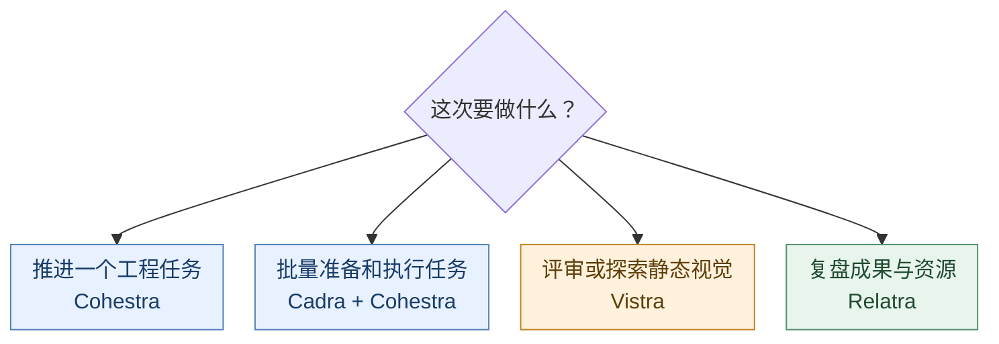
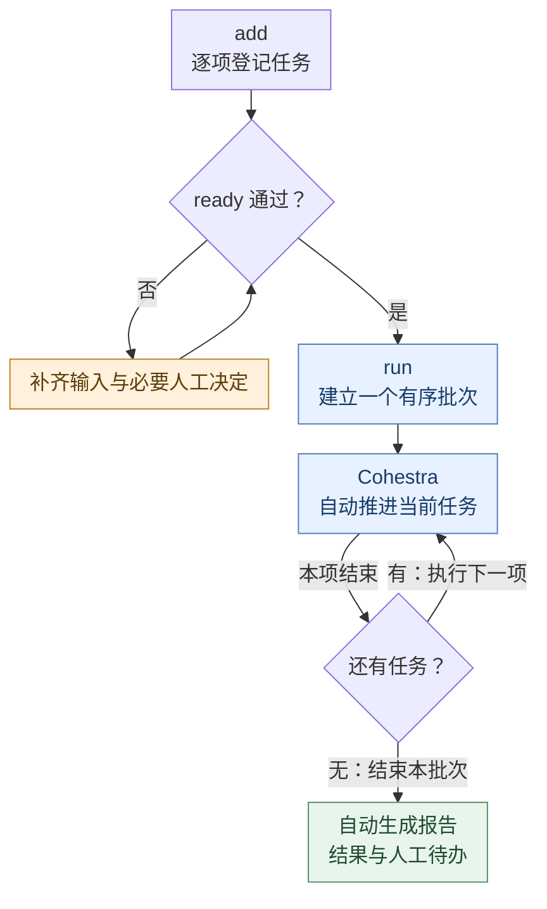
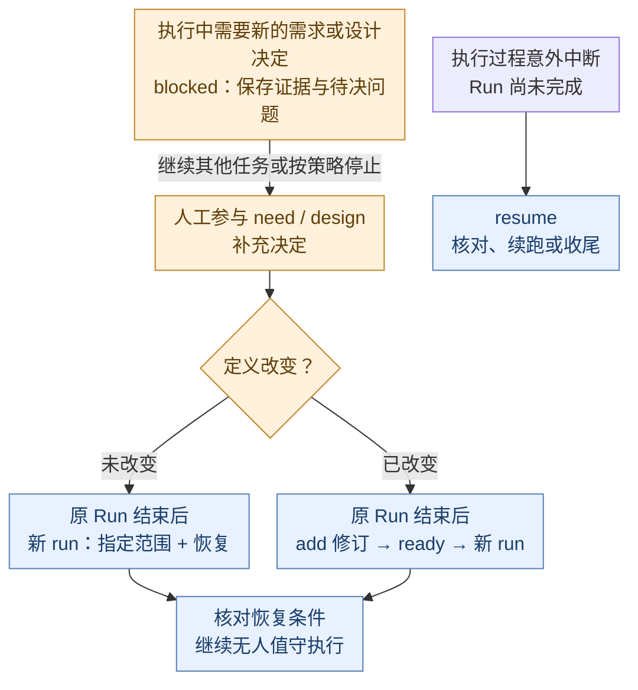
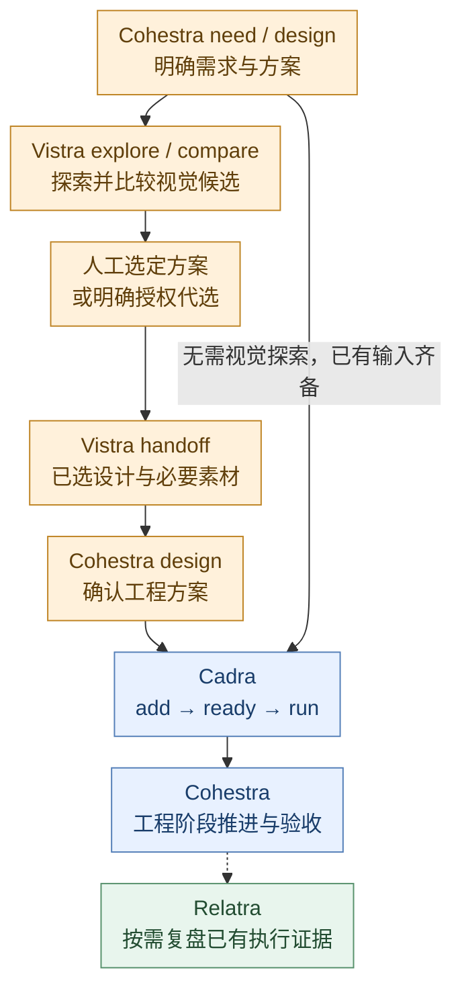

# YUZIO Skills

[English](README.md) · **中文**

集中维护可复用的智能体技能。各技能目录是完整安装单元；仓库中的测试与维护文档不随技能运行。

## 技能概览



| Skill | 用途 | 入口 | 版本与协议 |
|---|---|---|---|
| cohestra | 初始化项目上下文，按需执行工程阶段、偏差核对和只读报告 | [SKILL.md](cohestra/SKILL.md) | [release.json](cohestra/release.json) |
| cadra | 准备任务、串行调用 Cohestra，并管理执行状态与恢复 | [SKILL.md](cadra/SKILL.md) | [release.json](cadra/release.json) |
| relatra | 汇总指定项目的 agent 成果、遗留与已观测资源 | [SKILL.md](relatra/SKILL.md) | [release.json](relatra/release.json) |
| vistra | 评审、探索、比较和交接移动端、桌面端及品牌静态视觉 | [SKILL.md](vistra/SKILL.md) | [release.json](vistra/release.json) |

执行规则以各包内文档为准。Cohestra 每次调用执行一个阶段；Cadra 的工程阶段执行需要可用的 Cohestra。Relatra 需要 Python 3.9+，仅使用标准库；Vistra 生成或编辑图片需要宿主提供图像能力。

## 安装

在目标项目根目录执行所需技能的安装命令：

```sh
npx skills add yuzio-ai/skills --skill cohestra
npx skills add yuzio-ai/skills --skill cadra
npx skills add yuzio-ai/skills --skill relatra
npx skills add yuzio-ai/skills --skill vistra
```

默认项目级安装；用户级加 `-g`，指定工具加 `-a <tool-a> <tool-b>`。本地未发布内容可使用源仓库绝对路径。也可把完整技能目录复制到宿主支持的位置，包含包内引用、模板、脚本及隐藏文件。安装不自动初始化业务项目。

安装、更新与排查见 [安装说明](cohestra/references/installation.md)。安装后确认宿主能发现入口，并核对实际加载目录与 `release.json`；同名项目级和用户级副本不能假定谁优先。更新技能不等于迁移已有项目资料，旧协议不支持时应保留现场并按对应技能规则处理。

## 调用

快速定位：[Cohestra](#cohestra) · [Cadra](#cadra) · [Relatra](#relatra) · [Vistra](#vistra)。

安装后，在智能体对话中输入 `$技能名 入口`，再补充项目、对象、目标和必要约束。下文示例都是**对话输入，不是终端命令**；`<…>` 替换为实际内容，其他宿主使用各自的技能调用方式。

未明确项目时，Cohestra 和 Cadra 默认使用当前任务项目；Relatra 需要确定项目集合，Vistra 需要明确设计对象。只讨论技能规则不会启动执行。各技能可独立使用；组合任务只需安装所用技能及其实际依赖，不必每次串联全部 4 个。工程交付不自动授权提交、推送或发布。

| 术语 | 含义 |
|---|---|
| slug | 稳定任务标识，如 `search-history`；用于选择或编辑该任务 |
| Run / run-id | 一次执行批次及其标识；一个 Run 可包含多个任务 |
| handoff | 阶段交付文件；后续阶段通过实际路径读取 |
| candidate | 供审查或验收的固定实现版本，可以是提交或可复核快照 |

### Cohestra

用于推进单个工程任务。可以从任意阶段起步，**每次调用只执行一个阶段**；未指定入口时会根据目标选择。

| 入口 | 用法 |
|---|---|
| `init` | 初始化或复用项目协作上下文，不执行任务 |
| `need` | 澄清需求、范围和验收条件 |
| `design` | 制定方案、执行计划和验证方法 |
| `code` | 实施明确需求或有效设计 |
| `review` | 审查指定候选，列出问题 |
| `fix` | 裁决并修复审查问题 |
| `validate` | 补足验证证据，判断是否达到验收条件 |
| `verify` | 核对某阶段产出与上游依据之间的偏差 |
| `report` | 只读汇总当前项目任务、遗留问题和状态异常 |

```text
$cohestra design
项目：<项目绝对路径>
需求：为搜索增加历史记录，最多保存 20 条，支持单条删除和清空。
```

继续同一任务时，可附上前一阶段的交付文件或任务目录。阶段调用缺少上下文容器时会提醒并最小初始化；`report` 不初始化、不写文件。执行资料保存在项目 `.yuzio/cohestra`，必要正式文档按项目规范整理。

<details>
<summary>展开：验收、偏差核对及证据边界</summary>

`validate` 判断候选是否满足验收条件，`verify` 只检查阶段产出是否偏离上游，不修改实现、不补验收证据，也不替代审查。下面是两个独立调用，按实际目的选择；Cadra 不自动调用 `verify`：

```text
$cohestra validate
任务目录：<已有任务目录绝对路径>
候选：<固定提交 SHA 或可复核快照>
验收依据：<已确认的需求及验收条件>

$cohestra verify
被核对：<design 交付文件绝对路径>
上游依据：<对应 need 交付文件绝对路径>
```

接续任务时明确原任务目录，不能把“自动衔接”理解为自动执行后续阶段。阶段只读业务代码也可能写交付文件，只有 `report` 是不落盘的查询入口。检查和验收绑定固定候选，构建通过不等于运行验收通过；同一作者换阶段也不构成独立审查。

review 按适用风险核查真实调用方、装配与生命周期路径，证据覆盖固定候选及必要未修改依赖；零 findings 不代表覆盖完整。review 先在已有授权内补查，必要路径仍无法核实时受阻；validate 核对最终候选的覆盖及复审证据。详见[风险覆盖](cohestra/references/review-coverage.md)。单独调用默认单智能体；Cadra 明确安排的 worker/reviewer 按[编排派发](cohestra/references/workflow.md#编排派发)执行。

</details>

详细规则：[Cohestra](cohestra/SKILL.md)。

### Cadra

用于任务准备、串行执行和中断恢复。实际工程阶段由 Cohestra 完成。执行前确认目标是可安全写入的业务 Git 工作区，且实际加载的 Cohestra 支持 Cadra 所需契约和无人值守模式；Cadra 不代建 Git 仓库，也不在本技能源仓库执行业务任务。缺少项目容器时由对应写入口最小初始化，无需把安装和项目初始化混为一步。

| 入口 | 用法 |
|---|---|
| `add` | 新建或编辑任务定义，指定需求、优先级、依赖和流程 |
| `ready` | 检查目标、范围、验收、输入、依赖等是否满足执行条件 |
| `list` | 只读查看任务、队列和执行批次 |
| `run` | 创建执行批次，串行执行指定任务；默认选择全部 ready 任务，收尾后自动生成报告 |
| `append` | 向 running Run 尾部原子追加已通过准入的指定任务 |
| `resume` | 恢复或收尾尚未完成的执行批次，收尾后自动生成报告 |
| `report` | 为指定执行批次生成摘要文件，并登记报告链接 |

当前协议的 `report` 生成文件并登记链接；历史 0.6/0.7 Run 的 `report` 仅在对话中只读输出，不新增文件或链接。

`run` / `resume` 本次将 Run 收尾为 `completed`，或所有条目均已结束的 `stopped`，并成功回读后，自动为当前 Run 生成报告。最终回复直接给出 Run 与报告路径、结果数量及必要人工事项，使用已保存结果，不重跑工程阶段或验收。未完成 Run 不自动生成报告；对已结束 Run 重复 `resume` 保持只读，缺报告、需要阶段报告或不同关注点时手动调用 `report`。报告失败不改变执行结果；仅链接登记失败时保留文件，按准确路径补登记，不重新生成。必要的正式项目总结仍按项目规范处理。

推荐用 **Cadra 管理任务和执行批次，Cohestra 执行工程阶段**。`add` 只登记任务，`ready` 检查能否执行，`run` 才按任务流程自动调用 Cohestra。需求或方案尚未明确时，先单独调用 `$cohestra need` / `$cohestra design`，再通过 Cadra 的 `流程` 指定实施起点和允许范围。

`add` 按新建、编辑、绑定已有交付、旧协议升级四条路径限定读取范围。只校验定义、可达依赖图和 Run 归属，再保存并回读 Task；业务信息不足明确记缺口。编辑时维护修订，绑定时核对身份，不提前加载执行规则。依赖是否完成、候选适用性、完整执行契约和合法首动作由 `ready` 及后续执行检查；已有上下文可确认身份，不能豁免准入。独立读取合并，写前重读相关记录，不引入跨调用缓存或额外运行依赖。详见 [add](cadra/references/add.md)。

#### 选择流程

| 流程 | 起点 | 允许阶段 | 适用条件 |
|---|---|---|---|
| `implementation`（默认） | code | code、review、fix、validate | 目标、范围及授权明确，直接实施；尚需定位的缺陷也用此流程 |
| `bugfix` | fix | fix、review、validate | 已有明确缺陷、预期和整改依据 |
| `review-only` | review | review | 仅审查固定候选，不自动修复或验收 |

也可用仅含这四个阶段的非空列表。首项决定起点，其余项是允许范围，不是执行顺序，末项不声明终点。首次启动或需求/流程修订重启使用该起点；接续与恢复按合法契约及准入确定首个动作。实施后独立 review，必做整改经 fix 后复审，覆盖齐备、无必做整改且 flow 允许时才进入 validate；可选建议默认延后。`review-only` 遇必做整改会受阻，不扩大范围。

need/design 在 Cadra 外由人工参与准备；已有确认继续有效，小任务不必补造阶段文档。目标、验收、产品取舍或设计未明确时，先交互调用 `$cohestra need` / `$cohestra design`，再准备 Cadra 任务。执行中返回 need/design 会受阻交回人工，不判完成。

#### 各流程调用示例

下面是三个独立任务示例；替换输入路径和候选，每次调用分别发送。

```text
$cadra add
项目：<项目绝对路径>
任务：搜索历史
需求：按已确认方案增加最多 20 条搜索记录，支持单条删除和清空；不改搜索算法。
输入：<已确认需求、工程方案和必要视觉交付>
验收：重启后保留记录，删除与清空有效，超过 20 条移除最旧记录。
流程：implementation

$cadra add
项目：<项目绝对路径>
任务：修复空搜索崩溃
需求：按已有定位修复空输入崩溃；提示填写关键词且不发起请求。
输入：<复现记录、日志和已有定位依据>
验收：空输入不崩溃且不发请求，正常关键词仍可搜索。
流程：bugfix

$cadra add
项目：<项目绝对路径>
任务：审查账单导出实现
需求：审查固定候选的数据范围、CSV 内容和错误处理；不修改生产代码。
输入：<候选提交 SHA 或可复核快照>、<需求与验收条件>
验收：问题带位置、影响和证据；无问题时说明实际覆盖范围。
流程：review-only
```

#### 多任务自动执行



上图展示受阻或失败后继续下一项的默认行为；该任务的停止策略优先。

每次 `add` 返回一个 slug。对要执行的任务逐项 `ready`，全部通过后启动一个 `run`；不需要手工逐阶段调用 Cohestra。下面以一个 implementation 和一个 bugfix 为例，每条调用分别发送，等待上一步完成后继续：

```text
$cadra ready
任务：<implementation 任务的 slug>

$cadra ready
任务：<bugfix 任务的 slug>

$cadra run
范围：<implementation 任务的 slug>、<bugfix 任务的 slug>
```

**从回复里复制什么**：以下值仅示意，不代表已执行的任务。请使用本轮实际返回值；`YYYYMMDD` 是日期占位符，回复措辞不要求固定格式。

| 哪一步的回复 | 返回值示意 | 下一步填在哪里 |
|---|---|---|
| `add` | slug：`search-history` | `ready` 的任务、`run` 的范围 |
| `run` | run-id：`run-YYYYMMDD-01` | 中断时填 `resume` 的 Run；可选手动 `report` 的 Run |
| Cohestra 阶段 | 返回的 handoff 绝对路径 | 下游阶段输入，或 `add` 的参考输入 |

选任务和批次时复制标识；传交付材料时复制完整文件路径，包含文件名。

也可用 `范围：全部 ready`。任务按优先级从高到低执行，同级按 slug 字典序排列，范围列表顺序不控制执行顺序。默认某项受阻或失败后继续下一项；需要该项失败时停止队列，可在 `add` 中设置 `执行策略：stop_queue_on_failure: true`。

依赖必须已完成才能通过准入：B 依赖 A 时，先执行 A，再检查 B 的 `ready`，可追加到仍在 running 的 Run 或建立后续批次；不能把尚未完成的依赖链一次全部入队。同一项目最多有一个未完成 Run；中断用 `resume`，已结束批次的失败任务则在解决缺口后显式选择恢复范围，用新 `run` 执行。Cadra 主 agent 编排，按阶段需要为每项任务创建干净上下文的 worker 与独立 reviewer；`review-only` 不创建 worker，仅核对收尾不创建 agent。同任务优先复用各自角色，跨任务不复用，任务与阶段串行推进；无定时器或独立后台服务。缺少子 agent 或身份核验能力时明确受阻。

准备好新增任务后，可在原 Run 执行期间发送：

```text
$cadra append
Run：<running Run 的 run-id>
任务：<已 ready 的 slug 列表>
```

追加整批成功或整批拒绝。新增任务按优先级和 slug 排序后加入尾部，依赖须已完成；不会接管或唤醒执行者。interrupted 先恢复，已结束 Run 不重开。

| 执行中遇到什么情况 | 怎么处理 |
|---|---|
| 又有新需求 | 先 add、ready，再用 append 加到 running Run 尾部；不重排原队列 |
| 想主动停止 | 向正在执行的智能体发送下面的自然语言请求；没有 `$cadra stop` 入口 |

```text
停止当前 Run，并按 Cadra 规则收尾。
保留当前任务的实际执行结果，将后续未执行任务记为 skipped。
```

收尾保留实际结果，Run 记为 `stopped`，后续未执行项记为 `skipped`，随后自动生成报告；收尾中断时先用 `resume` 核对，完成后再建新 Run。

`run` 建立批次时仍会复核准入。任务执行有预算：每阶段失败重试最多 2 次、针对 review 阻塞问题的 fix 最多 3 轮、每任务每 Run 总调用最多 16 次；仍需调用而预算不足时记为 failed 并列出人工待办。`resume` 不清零预算。详见 [调用契约与预算](cadra/references/contract.md)。

用 `list` 查看实际 slug、当前状态和 Run；手动 `report` 不指定 run-id 且存在多个已结束批次时，不会默认猜测“最新”一批：

```text
$cadra list
项目：<项目绝对路径>
```

| 状态 | 实际含义 | 接下来检查什么 |
|---|---|---|
| Run completed | 本批次所有项已结束，仍可能包含受阻或失败项 | 逐项看结果与人工待办 |
| Task completed | 已完成配置的任务范围 | 核对 flow 和 acceptance；仅审查不等于工程验收 |
| Task skipped | 本轮未执行 | 选入新批次前仍需核对原准入和恢复条件 |

#### 人工决定与恢复



Cadra 以 `unattended` 模式派发 code/review/fix/validate，不派发 need/design。若执行中新发现必须由用户作出的需求或设计决定，或下一步指向 need/design，则保存已有调查、方案及待决问题，将该任务标为 `blocked` 并交回人工准备；不在 Run 内切换为交互模式等待回答，也不按流程越界判为完成。

| 准备缺口 | 需要人工参与的例子 | 当前任务的处理 |
|---|---|---|
| 需求决定 | 无法确定本次是否包含跨设备同步，现有需求不能给出答案 | 记录范围选择及其影响，受阻后交回人工参与的 `need` |
| 设计决定 | 出现超出现有授权的重大架构取舍，需要用户选择或确认 | 保存候选、推荐依据与待决项，受阻后交回人工参与的 `design` |

Cadra 将人工待办记入 Run。默认继续执行队列的下一项；该项设置 `stop_queue_on_failure: true` 时停止队列，并将尚未执行的项记为 skipped。先查看该 Run 的 `report`，按其中的实际问题补充决定。

<details>
<summary>展开：恢复命令、任务修订与中断续跑</summary>

**受阻任务在原 Run 中已有结束结果，补充决定后不会自动重跑。** 根据是否改变任务定义选择恢复方式：

- **只补充决定，任务定义不变**：原 Run 已结束、项目无其他未完成 Run，且受阻原因已解除后，显式指定 slug，创建新 Run 恢复。不能用“全部 ready”代替恢复范围。下面的示例适用于已有方案选择，且不改变原任务范围、流程、依赖、执行策略或验收条件：

```text
$cadra run
项目：<同一项目绝对路径>
范围：<受阻任务的 slug>
恢复：<同一 slug>
补充：已确认采用 <need/design 交付文件绝对路径> 中的方案 A；原任务范围、流程和验收条件不变，允许按该决定继续执行。
```

- **决定改变任务定义**：等原 Run 结束后，先用 `add` 编辑原 slug 并说明变更，再 `ready`，最后用 `run` 的普通范围选择该 slug；修订后的任务不填入 `恢复` 列表。Cadra 仍核对原受阻原因是否解除，并按修订规则决定起点，不把旧验收当作新需求的验收。

恢复不是直接跳过受阻阶段。Cadra 核对交付与恢复条件后，选择合法下一步，或在允许范围内重试原受阻阶段；后续继续使用无人值守模式。详情见 [恢复准入](cadra/references/recovery.md) 和 [定义修订](cadra/references/revision-rules.md)。

冻结 Run 前检查项目和任务前提；未来阶段产物不作为准入输入，见 [执行预检](cadra/references/preflight.md)。Run 写入需要 Python 和 POSIX 文件锁。恢复前先核对 [执行归属](cadra/references/executor.md)：活跃或活性未知不授权接管。[版本边界](cadra/references/compatibility.md) 保留旧 Run，Task 需显式升级；旧未完成 Run 使用原安装副本继续。

**`resume` 处理已确认的执行中断**，用于未完成 Run 的核对、续跑或收尾；不会重新执行其中已有 blocked/failed 结果的条目，也不会重开已结束的 Run：

```text
$cadra resume
Run：<未完成的 run-id>
```

</details>

需求或设计需要讨论时，先交互完成 `$cohestra need` 或 `$cohestra design`，再用 implementation 交给 Cadra。接续已有 Cohestra 任务时提供原任务目录并明确确认绑定，其合法下一阶段必须在新版允许范围内。

编辑任务时用 `add` 指定已有 slug。属于未完成 Run 的任务不能编辑，即使该条目已经结束。改变需求、依赖、流程或执行策略会使准入失效，需要重新 `ready`；只改标题或优先级不使准入失效。slug 和 Cohestra 绑定路径保持稳定，不靠重命名或复制旧记录恢复。

不同目标的新任务也可以参考已有 Cohestra 交付，但这不等于接续原任务；同一目标应复用原任务。接续时 Cadra slug 必须与原 Cohestra 任务标识一致，提供原目录并明确确认绑定；实际首个动作还取决于合法契约，而不是只看所选 preset。契约、索引或来源记录损坏时应先报告并修复，不能删掉 `.yuzio` 重新初始化来代替恢复。

任务定义和执行记录保存在 `.yuzio/cadra`。完整流程与准入定义见 [Flow](cadra/references/flow.md) 和 [Task 与 Ready Gate](cadra/references/task-rules.md)。

详细规则：[Cadra](cadra/SKILL.md)。

### Relatra

用于个人项目复盘。支持日报、周报、月报、季报、年报和自定义起止日期。

```text
$relatra 周报
项目：<项目绝对路径，可明确列出多个项目>
报告目录：<报告目录绝对路径>
```

默认统计上一完整自然周期，使用中文和上海时区，周报为周一至周日。要看本期进展，明确写“本周截至现在”；要分析返工、人工介入或等待，直接补充这些要求。

普通模式汇总成果、状态、遗留及可观测时间和 token；效率诊断使用深度模式。单项目默认目录为 `<项目>/.yuzio/relatra`，跨项目需明确统一报告目录。可更正历史报告并保留旧版。

需要 Python 3.9+，并能读取所选项目的本机会话日志及支持的工作流证据；不保证覆盖云端、已删除或其他机器上的记录，也不代表首次采集已盘点所有历史遗留。没有可用证据时保留待确认，缺失时间和 token 不按零统计，不换算费用或人工工时。

<details>
<summary>展开：自定义周期、深度分析和报告更正</summary>

自定义周期、深度分析及历史更正可直接说明，下面每条调用分别发送。更正由技能更新完整账本并生成新报告版本，不手工覆盖旧 `report.md` 或改动源日志：

```text
$relatra
项目：<项目绝对路径>
周期：<起始日期 YYYY-MM-DD> 至 <结束日期 YYYY-MM-DD>，包含结束当天
要求：深度分析返工、人工介入和等待，保留证据覆盖不足的说明。

$relatra 周报
项目：<与原报告一致的项目集合>
报告目录：<原报告目录绝对路径>
更正对象：<原报告版本目录绝对路径>
更正：<需要拆分、归并或修正的目标及理由和证据>
```

需要前期比较时提供同范围、可比周期的已封存报告路径作为基线；复用旧账本不等于自动建立比较基线。只汇总证据，不执行原任务或改变其状态，不自动定时运行、上传日志或发送报告。

</details>

详细规则：[Relatra](relatra/SKILL.md)。

### Vistra

用于移动端、桌面端和品牌的静态视觉工作。提供截图、素材、源码或准确候选，并说明本轮可改范围。

| 入口 | 用法 |
|---|---|
| `review` | 检查已有页面或素材，给出问题和建议 |
| `explore` | 生成或编辑图片，探索布局、配色、Logo 等方向 |
| `compare` | 比较已有方案，说明取舍 |
| `handoff` | 记录选定方案和采用范围，整理开发交接 |

```text
$vistra explore
对象：<页面截图或设计素材>
目标：探索 3 个视觉方向，突出主要操作。
约束：保留文案、功能和导航，仅调整布局、层级和配色。
```

多方向探索默认 3 个方向、最多一轮针对性修订，可明确调整预算。需要生成或编辑图片时，宿主必须提供图像能力。

在已有候选上下文中，“就用 B”会记录选择并进入交接；需要只记录选择时应明确说明。交接缺少关键决定或素材时会保留草案状态。Vistra 不直接修改生产代码，不制作 HTML 或交互原型，图片也不代表工程验收通过。

<details>
<summary>展开：评审与比较示例、配置及产物位置</summary>

已有页面先评审，已有至少两个可读候选可比较；这两个模式不要求重新出图。下面是独立调用示例，评审建议不自动启动探索，比较推荐也不自动成为已选方案：

```text
$vistra review
对象：<实际页面截图或素材绝对路径>
范围：信息层级、主要操作和规范一致性；只读评审，不生成替代稿。

$vistra compare
候选：<候选 A 的准确路径及版本>、<候选 B 的准确路径及版本>
目标：比较主要操作的突出程度和信息可读性；给出推荐，暂不记录采用。
```

提供适用的项目规范、品牌和参考来源；`.yuzio/vistra/profile.yaml` 是可选复用配置，不是使用前提。只有源码时能检查结构和策略，不能据此声称画面质量已通过。普通本机产物默认保存在 `.yuzio/vistra/artifacts/<任务标识>/`；正式 handoff 需携带准确候选、必要图片与资源映射，不能只剩临时图片路径。

</details>

详细规则：[Vistra](vistra/SKILL.md)。

### 配合使用



单个工程任务可直接使用 Cohestra；多个需求推荐用 Cadra 准备任务，再串行调度 Cohestra。Cadra 的流程只包含 Cohestra 的工程阶段，Vistra 不是可填写的 flow 阶段；工程阶段可按需使用视觉专项能力，但不能据此跳过必要决定。

涉及新视觉方向时，推荐先完成 **Vistra explore/compare → 人工选定准确候选 → Vistra handoff → Cohestra design → Cadra add → ready → run**。Vistra handoff 是工程输入；必要的工程设计先在 Cadra 外与用户确认。可以提前 `add` 为草稿，但视觉方向或关键素材未定时不能通过 `ready`；无需视觉探索的任务可直接准备 Cadra。

视觉探索通常需要人在环中选择或反馈。Vistra 也支持明确授权后的代选，因此并非每次都必须人工选案；未授权代选时，不能让 Cadra 自行裁决。无人值守阶段遇到缺失决定或权限，应记录受阻。Relatra 在执行后汇总实际成果和遗留。

查看状态时：`cohestra report` 看项目任务总览，`cadra report` 生成某个执行批次的摘要，`relatra` 生成指定周期的成果与资源报告。

#### 含人工视觉决策的完整示例

以“给现有搜索页增加历史记录”为例：Cohestra 明确需求 → Vistra 探索并交接 → Cadra 调度 Cohestra 实施和验证 → Relatra 复盘。

第 1–3 步先完成需求准备与视觉选择，第 4 步登记工程任务，第 5 步由 Cadra 自动调度 Cohestra，第 6 步复盘；不是用一个 `run` 自动完成全部视觉决策。在同一个目标项目中依次发送下列调用，每次等待交付后再继续。把路径、候选版本、slug 和 run-id 替换为实际返回值。开始前需安装这 4 个技能，项目已是 Git 工作区，并具备图像能力和所需验证环境。

<details>
<summary>展开：完整六步示例与可复制调用</summary>

1. 先明确需求，解决影响实现的产品问题。

   ```text
   $cohestra need
   项目：<项目绝对路径>
   需求：为现有搜索页增加历史记录，最多 20 条，支持单条删除和清空，重启后仍保留。
   范围：不改搜索算法和其他页面；明确交互规则与验收条件。
   ```

2. 用需求交付和现有页面探索视觉方向。

   ```text
   $vistra explore
   项目：<同一项目绝对路径>
   依据：<need 返回的需求交付文件绝对路径>
   对象：<现有搜索页截图或源码路径>
   目标：探索 3 个搜索历史区域的视觉方向。
   约束：沿用品牌、文案和导航，不增加需求以外的功能。
   ```

3. 查看候选并作出选择后，整理正式交接；关键决定或素材未齐时先补齐。

   ```text
   $vistra handoff
   项目：<同一项目绝对路径>
   选择：<已查看并确定采用的候选及准确版本>
   要求：保存正式交接，明确采用范围、组件映射和未决项，供后续工程设计使用。
   ```

4. 先针对同一任务完成工程设计与必要决定，再登记 Cadra 定义；沿用原 Cohestra slug，提供原目录并确认绑定，核对合法下一步为 code。两次调用分别发送。

   ```text
   $cohestra design
   任务目录：<第 1 步的 Cohestra 任务目录绝对路径>
   输入：<need 交付>、<Vistra 正式交接>
   要求：确认工程方案、验收方法和实施授权，交付后停止。

   $cadra add
   项目：<同一项目绝对路径>
   任务：<第 1 步返回的 Cohestra 任务 slug>
   需求：沿用第 1 步已确认的搜索历史需求，按已选视觉方案实施；不改搜索算法和其他页面。
   原任务目录：<第 1 步的 Cohestra 任务目录绝对路径>
   绑定确认：确认这是同一目标，接续上述任务，沿用已有需求和授权。
   输入：<需求交付文件绝对路径>、<design 交付文件绝对路径>、<Vistra 正式交接文件绝对路径>
   验收：最多 20 条，单条删除与清空有效，重启后保留；按需求交付中的完整验收条件验证。
   流程：implementation
   ```

5. 分别发送 `ready`、`run`。仅在准入通过后执行 `run`；Cadra 按实际结果调用 Cohestra 的开发、独立审查、修复和验收阶段，收尾后自动生成报告。运行中断时先用 `resume` 恢复。

   ```text
   $cadra ready
   任务：<add 返回的 slug>

   $cadra run
   范围：<同一 slug>
   ```

6. 最后复盘本周截至当前的实际成果。Vistra 目录不由 Relatra 自动采集，显式提供交接引用供核对，并以可读取的会话或工具证据确认实际交付；单给路径不保证能纳入统计。证据缺失时保留待确认，未完成和未验收事项仍列为遗留。

   ```text
   $relatra 周报
   项目：<同一项目绝对路径>
   周期：本周截至现在
   补充证据：<Vistra 正式交接文件绝对路径>
   关注：搜索历史功能的实际交付、验收状态、遗留问题和可观测资源。
   ```

</details>

| 详细说明 | 入口 |
|---|---|
| Cohestra 阶段、交接与契约 | [公共流程](cohestra/references/workflow.md) |
| Cadra 准备、执行与恢复 | [公共流程](cadra/references/workflow.md) |
| Relatra 数据调用与统计口径 | [数据与调用](relatra/references/data.md) · [统计口径](relatra/references/metrics.md) |
| Vistra 模式、项目规范与配置 | [模式](vistra/references/modes) · [项目适配](vistra/references/project-adapter.md) |

## 本机资料与正式文档

`.yuzio/` 保存当前工作区的本机执行资料，根 `.gitignore` 使用 `/.yuzio/` 排除它。忽略不等于可丢弃或已有备份。需要共享的正式结论和附件进入项目文档目录，并可脱离本机资料读取。

各包独立携带具体约定：[Cohestra](cohestra/references/storage.md) · [Cadra](cadra/references/storage.md) · [Relatra](relatra/references/storage.md) · [Vistra](vistra/references/storage.md)。

## 维护与检查

仓库根目录运行全部自动化检查：

```sh
python3 -B -m unittest discover -s tests -p 'test_*.py'
```

测试布局、单技能命令与验收场景见 [测试说明](tests/README.md)。检查覆盖包元数据、文档链接、隔离副本资源完整性及离线回归；实际安装器行为、智能体执行和视觉验收单独验证。

版本与协议在各包 `release.json` 维护，更新条件、兼容性和提交前检查见 [维护与版本规则](AGENTS.md#版本管理)。保持中英文 README 同步。提交、推送和发布标签需明确授权。许可证：[MIT](LICENSE)。
